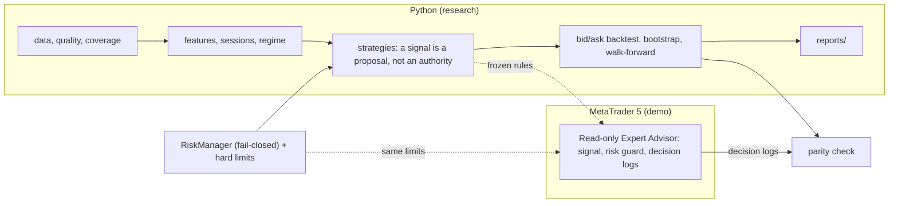

# xauscalp

**A research system built to ask one question carefully: is there a net statistical edge in short-term gold (XAUUSD) trading?**

> **Status: archived. Conclusion: no statistically validated trading edge.**
> None of the strategies tested showed a net edge after costs under the project's criteria. This does not prove that no profitable strategy exists; it says that this work did not find one it could defend. This is **not** a trading bot, not a financial product and **not financial advice**. Live trading is disabled in code, and **nothing in this repository can send an order**: the one component that could was deliberately left out (see [What is not included](#what-is-not-included)).
>
> **Developed with AI assistance.** The code, tests, audits and report drafts were produced with Claude Code. See [How it was built](#how-it-was-built).

&nbsp;

## What this repository shows

| Aspect | What the repository documents |
|---|---|
| **Protocols written down** | The project's documents (`docs/`, in Spanish) set out hypotheses, parameters, cost scenarios and verdict rules as fixed before each study ran. This repository's Git history starts from a clean snapshot, so it is **not** evidence of that order. See [About this repository's history](#about-this-repositorys-history). |
| **A negative result, argued** | Three studies end without evidence of a net edge, including why the nearest candidate looks like long-only market exposure rather than a signal. |
| **Walk-forward validation** | Parameters are chosen on training windows only and evaluated on the following test windows, with week-block bootstrap intervals and a random-direction comparison. See [Method](#method). |
| **Fail-closed risk management** | The risk manager rejects anything it cannot verify, and a hard-limit module caps what configuration can ask for. |
| **Cross-language parity** | The Python research code and the read-only MQL5 Expert Advisor were compared on the same data. |
| **Audit loop** | Several audit rounds with severity-ranked findings, fixes and regression tests (`docs/auditoria_2026-11-12.md`, `docs/decisiones.md`). |
| **Reproducibility** | `uv` lockfile, one script per study, reports regenerated from code. |
| **Data hygiene** | A locked holdout period, coverage declarations, and studies marked *not validable* when coverage is insufficient. |

&nbsp;

## Results

| Study | Question | Outcome |
|---|---|---|
| **7.** Opening-range breakout on broker history (15 walk-forward folds, cost scenarios fixed beforehand) | Does it have a net edge? | **No evidence of one.** Out-of-sample expectancy in the primary scenario (222 trades): −0.113 R, 95% interval −0.253 to +0.026, which includes zero. The two other scenarios have intervals entirely below zero. Even with zero costs the estimates stay below zero (−0.028 R, −0.023 R and −0.173 R across the three scenarios). |
| **8.** Four preregistered families (trend, momentum, pullback, mean reversion), 22 configurations | Does an alternative work? | **No validated edge.** The closest, an H1 Donchian trend strategy (159 trades, +0.242 R), fails three preregistered criteria: its interval's lower bound is below zero (−0.024 R), and its profit comes mostly from long positions in the 2025 folds, with five trades supplying 71% of the total (a post-hoc observation). Mean reversion traded in only 1 of 15 folds (48 trades, −5.4 R). |
| **9.** FTMO 2-Step simulation (two-level Monte Carlo with a null control) | Is the challenge worth attempting on these results? | **Not on this evidence.** A random strategy with no edge still "passes" between 8.5% and 15.0% of simulated attempts at 0.5% risk (8.5% with the breakout trades, 9.0% with Donchian, 9.8% with pullback and 15.0% with momentum), so a pass rate means nothing without a null control. The Donchian candidate's estimated pass rate, 49%, has an interval of 9% to 88%. |

*R is the amount risked per trade. Out-of-sample means data not used to choose parameters. "Preregistered" and "fixed beforehand" describe what the project's documents record. Figures are from the reports in `reports/`; the portfolio page lists each one with its source.*

&nbsp;

## Architecture



**Why this shape.** The `MetaTrader5` Python package ships only Windows wheels and the research machine is a Mac. So research stays in Python, and the MetaTrader side is an Expert Advisor running inside MetaTrader 5 with no process link to Python. The price of that choice is that the rules exist twice, which is why a parity check is mandatory. The Expert Advisor published here is the read-only one: it computes the signal and the risk decision and writes logs, which is all the parity check needs.

**Risk limits.** The *default settings* (`config/default.yaml`) are: mandatory stop-loss, 0.5% risk per trade, −2% daily and −5% weekly loss limits, a drawdown lock at −8% from peak, at most 3 trades per day and one position at a time, no martingale, grid or averaging, demo accounts only. Separately, *hard caps enforced in code* (`HARD_LIMITS` in `src/xauscalp/config.py`) stop any configuration from exceeding 1% risk per trade, 3% daily and 6% weekly loss, a 10% drawdown lock, 10 trades per day, one open position and 50% margin usage.

&nbsp;

## Method

- **Data.** One-minute bid/ask bars from a demo broker feed. Study 7 uses 2021-01-03 to 2025-10-31: 1,707,302 bars, 98.1% of days covered. A study is marked *not validable* when coverage is insufficient.
- **Walk-forward.** In each fold, the parameters (36 configurations per cost scenario, chosen per session) are selected on the training window only and then applied to the following test window. Study 7 has 15 valid folds. The trades of the test windows are the out-of-sample sample.
- **Costs.** Execution uses bid and ask, and three cost scenarios were written down before the study ran, the last one a stress scenario.
- **Uncertainty.** 95% confidence intervals by bootstrap, resampling whole ISO weeks to keep dependence inside a week, and a comparison against random trade direction. A strategy has to meet all the criteria that were fixed beforehand, not just a positive average.
- **Holdout.** Data from the configured holdout start is locked: opening it is a one-shot, logged act that needs an explicit environment flag, and the loaders stop at the research boundary.

&nbsp;

## Engineering notes

**A fail-open risk manager, found by audit.** The first audit found that the risk manager *approved* trades when spread, data age or free margin was `NaN`. It now rejects any non-finite or out-of-range input, with regression tests.

**Parity, and the bug it exposed.** Python and the EA disagreed on two Monday sessions. An indicator window defined as "502 bars" was measured in wall-clock time, so Monday mornings, after the weekend gap, held about 110 bars and the smoothing seed had not decayed. After the fix the two implementations were **equivalent on 90 day-sessions with 0 hard differences** (88 SIGNAL, 2 NO_BREAKOUT). The report itself says what this does and does not mean: it shows the calculations match; it says nothing about profitability, and because the trigger fires on almost every session, signal parity is not a selective test.

**Holdout leakage, found and closed.** An audit found that a loader decoded files from the locked holdout period before trimming them. Readers now stop at the research boundary, enforced by a static test.

**Execution policy as a tested specification.** MQL5 cannot be run in the research environment, so the decisions that protect money in an order-sending component (ambiguous return codes, reconciliation, lockouts) are written as a Python specification (`execution_spec.py`) with tests, and a mock-broker failure-injection suite (`execution_sim.py`) that runs the policy against random failures. The MQL5 engine that this specification describes is not published here, so this repository does not compare the two.

&nbsp;

## Tests

This repository has **636 automated tests** across 24 files: unit tests, MQL5 static scans, specification-versus-implementation checks and simulations with mocks. Executed on 2026-11-16 from a fresh install of this exact content (Python 3.12.10, no market data, no broker): **636 passed, 0 skipped**.

The private development repository has 727 tests. This repository publishes 636 because it leaves out 62 tests that check the configuration of the AI tool used in development (a guard hook and permission proposals) and 30 that check the order-sending component, which is not published, and because it adds one regression test that the development repository does not have (727 - 62 - 30 + 1 = 636). The suite covers the Python side and static scans of the MQL5 that is published; the MQL5 programs cannot be run outside MetaTrader, and their compile status is recorded in `reports/mt5_build/`.

&nbsp;

## Reproducing

```bash
uv sync --extra dev
uv run pytest                           # synthetic data and mocks only
uv run ruff check src tests research
```

**What can be run.** The whole test suite, with the data it generates itself. The study scripts in `research/` need one-minute data that you provide:
- export it from **your own** MetaTrader 5 demo account with the scripts in `mt5/` (`docs/05_mt5_instalacion_y_pruebas.md`), or
- download Dukascopy files yourself with the project's downloader, following `docs/04_fuentes_de_datos.md` and the provider's terms.

**What is not included.** Market data is not included: Dukascopy files and broker exports are not redistributed. The trade-level and decision-level CSV files derived from that data are not included either; the reports in `reports/*.md` keep the figures they produced. The documentation in `docs/` is in Spanish.

**Safety.** No Python code in this repository connects to a broker or places orders, and none of the commands above touches MetaTrader. The MQL5 that is published is read-only or exports data, and `tests/test_mql5_static.py` fails if any of it contains an order-sending call. The Python modes guard keeps `LIVE` disabled.

&nbsp;

## Limits of this work

- Level-1 simulation on one-minute bars; the MetaTrader Strategy Tester was modelled from those bars, not from real ticks.
- Broker history came from a demo feed with derived ask prices and optimistic spreads.
- One instrument, a limited period, and no live or demo order trading in this repository.
- Multi-asset research is designed and unit-tested on synthetic data; it was **not run**.

&nbsp;

## How it was built

Python, MetaTrader 5 and MQL5, `uv`, pytest and ruff, developed **with Claude Code** (Anthropic's AI coding assistant).

- **Done by Claude Code:** the implementation, the test suite, the independent read-only audits and their regression fixes, and the drafts of the reports. Claude Code ran the tests and the audits. This repository does not claim hand-written code.
- **My part:** I set the research question and the risk constraints, supervised the work, reviewed the results and decided what could be claimed from them. This page does not credit any test run or audit to me.

&nbsp;

## What is not included

The development repository also has an MQL5 Expert Advisor that can send orders (`XauScalp_Exec` and its engine `ExecEngine.mqh`), with a Python audit tool for its dry-run output and the dry-run evidence. They are **not published here**. Reasons: this repository is a research and engineering showcase, not a trading tool; and the research conclusions, the risk code and the parity evidence do not depend on them. That component was only ever run in dry run, with trading disabled, and sent no orders. Some documents and decision records still refer to it; those references are left as they were written.

&nbsp;

## Repository map

| Path | What it holds |
|---|---|
| `src/xauscalp/` | The Python package: `data/` (loading, quality, coverage, downloader), `features/`, `strategies/`, `backtest/` (engine, metrics, walk-forward splits), `risk/` (manager and sizing), `propfirm/` (rules and Monte Carlo), `parity.py`, `execution_spec.py`, `execution_sim.py` |
| `research/` | One script per study, numbered in the order they were run |
| `tests/` | 24 test files |
| `mt5/` | Read-only Expert Advisor, its include files and export scripts (MQL5) |
| `reports/` | The output of each study, with the figures quoted above |
| `config/` | Default settings, the economic-event calendar and the simulated challenge rules |
| `docs/` | Working documents, in Spanish; [`docs/INDEX.md`](docs/INDEX.md) lists them in English |

&nbsp;

## About this repository's history

This repository starts from a clean snapshot of the project with a new Git history. The original development history is kept private, and the files that were never meant for publication are left out: the internal configuration of the AI assistant, the market data and the CSV files derived from it, and the order-sending component described above. Compared with the development repository, this one changes only the following, and no study, result, risk limit or strategy: (1) `download_range` in `src/xauscalp/data/dukascopy.py` now skips futures that were cancelled when the downloader's circuit breaker trips; without it, that path could raise `CancelledError` depending on thread timing, which was found while checking this reduced suite; (2) a regression test for that fix, `test_circuit_breaker_with_pending_jobs_does_not_raise_cancelled_error`, which fails on the unfixed code; (3) a note at the top of each document that mentions the excluded component, and some comments and docstrings corrected so that they do not describe tests or files that are not here. The protocols, decisions and reports in `docs/` and `reports/` document what was planned, decided and found, but **this repository's commit history does not show the order in which things were done**.

**Files mentioned but not published.** Some comments and reports refer to material that is deliberately not part of this repository: `CLAUDE.md` and `security/` (internal configuration of the AI assistant), the guard hook of that configuration, the order-sending component (`mt5/Experts/XauScalp_Exec.mq5`, `mt5/Include/XauScalp/ExecEngine.mqh`, `src/xauscalp/exec_audit.py` and `reports/exec_dryrun/`), and the CSV files listed in `reports/parity/SHA256SUMS`. The public version of `docs/auditoria_2026-11-12.md` and `docs/decisiones.md` omits the findings and decisions about that configuration; the technical findings about the research and execution code are kept.

&nbsp;

## Licence and use

This repository is offered for **review and evaluation of my work**. It carries no licence: no general permission to reuse, copy, modify or redistribute the code, documents or reports is granted. Reading it and running the tests to review it is what it is for. If you would like to reuse something, please ask first.

&nbsp;

## Disclaimer

Past or simulated results do not guarantee future results. This repository is for review and research purposes and is not investment advice. `config/propfirm_ftmo_2step.yaml` paraphrases publicly available rules of a third-party firm, read on 2026-11-15, for simulation only; those rules may have changed. The simulations are **not** an FTMO certification, and nothing here implies eligibility, endorsement, affiliation or profitability.
